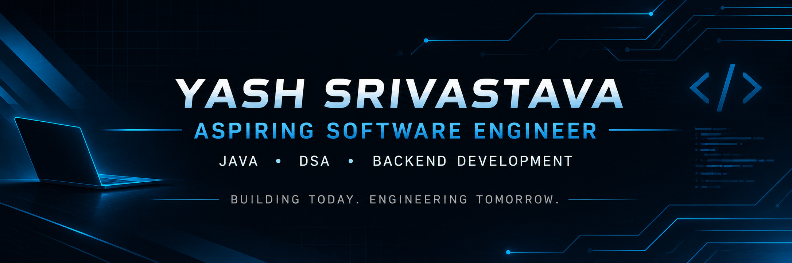

 <!-- Profile Banner -->

  

<h1 align="center">Building Software, One Problem at a Time.</h1>

<h3 align="center">
  Computer Science Engineering Student | Aspiring Software Engineer
</h3>

  Focused on Java, Data Structures & Algorithms, Backend Development and building practical software projects.

  
  
  

---

## 👨‍💻 About Me

I'm a Computer Science Engineering student passionate about software development, problem-solving and continuous learning.

I enjoy turning ideas into practical applications while strengthening my programming fundamentals and understanding of software engineering.

- 🎓 Pursuing B.Tech in Computer Science Engineering.
- 💻 Currently focusing on Java and Object-Oriented Programming.
- 🧠 Practicing Data Structures & Algorithms through LeetCode.
- ⚙️ Exploring backend development with Spring Boot and FastAPI.
- 🚀 Building projects to gain practical development experience.
- 🎯 Working towards becoming a Software Development Engineer.

---

## 🛠️ Technologies & Tools

**Programming Languages**

  

**Frameworks & Databases**

  

**Development Tools**

  

---

## 🚀 Featured Projects

### 1. FocusForge
**Java | Spring Boot | Spring Data JPA | H2 Database**

A student productivity platform designed to help users organize and manage their tasks.

- Implemented REST APIs for task management.
- Worked with Spring Data JPA and H2 database.
- Added request validation and exception handling.

[View Repository](https://github.com/IMyash5/FocusForge)

### 2. CropMart
**Python | FastAPI | SQLAlchemy | SQLite**

An AI-powered farm-to-market marketplace designed to connect agricultural products with potential buyers.

- Developed backend functionality using FastAPI.
- Worked with SQLAlchemy and SQLite.
- Implemented authentication and API-based application features.

[View Repository](https://github.com/IMyash5/CropMart)

### 3. Crypto World
**Web Development | Cryptocurrency**

A cryptocurrency information and price-tracking project.

- Explored cryptocurrency-related information.
- Built an initial web development project.

[View Repository](https://github.com/IMyash5/crypto-world-learn)

---

## 📚 Currently Learning

- Java Programming and OOP Fundamentals
- Data Structures & Algorithms
- Problem Solving through LeetCode
- Backend Development with Spring Boot
- Database Management and SQL
- Software Engineering Fundamentals

---

## 🎯 Goals for 2026–2027

- Strengthen Java and DSA fundamentals.
- Build production-oriented software projects.
- Improve backend development skills.
- Gain practical industry experience through an internship.
- Improve problem-solving and technical communication.
- Prepare for Software Engineering placements.

---

## 📊 GitHub Statistics

  
  

  

---

## 🤝 Leadership & Activities

**Vice President | Swaraang, MIET**

- Contributing to the coordination and management of the college music club.
- Participating in student engagement and club activities.
- Developing teamwork, communication and leadership skills.

---

## 🤝 Let's Connect

I'm always open to connecting with fellow developers, learning from experienced engineers and exploring opportunities to grow.

  <a href="https://github.com/IMyash5">GitHub</a> •
  <a href="https://www.linkedin.com/in/yash-srivastava-a45512361/">LinkedIn</a> •
  <a href="https://leetcode.com/u/KtDzMCykch/">LeetCode</a>

  <i>"Consistency, curiosity and continuous improvement."</i>

  ⭐ Thanks for visiting my profile!

